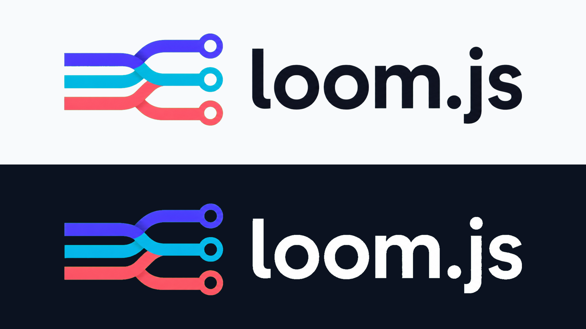

# Loom.js

Loom.js is a provider-neutral runtime for composing AI agents in browser-capable JavaScript
environments. Its core behaves like a small operating system: plugins declare what they provide, the
runtime validates and orders them, and consumers resolve capabilities through stable public
contracts.

Phases 1 through 5.5 are consolidated on `master`. Phase 1 established the architecture-only
runtime. Phase 2 added a minimal Codex-style orchestration plugin and text-workspace tools. Phase 3
added replaceable browser plugins for explicit host capabilities, IndexedDB storage, and File System
Access workspaces. Phase 4 added a provider-neutral Manifest V3 credential broker and a Loom
authentication adapter. Phase 5 adds an isolated, disabled-by-default Codex authentication
experiment based on an audited open-source CLI revision. Phase 5.5 adds a runnable experimental
vertical slice: a provider-specific model leaf, extension-owned provider transport, status/logout,
and a localhost browser application. The current work adds reusable coding sessions, binary project
workspaces with safe ZIP transfer, and isolated QuickJS, WebContainer, and Pyodide adapters behind a
multi-mode browser workbench. Core and the agent packages remain free of provider, browser, and
extension APIs. Loom now also includes a separate adapter for the documented OpenAI Platform
Responses API; applications must still supply a secure transport or trusted-host credential source.
Loom contains no supported OpenAI OAuth product or built-in API-key host.

The project now includes a browser-readable front page and onboarding manual. After serving the
`packages` directory, open `http://localhost:4173/example-codex-experimental/` to learn what the
library provides, read the guided documentation, and then enter the clearly separated experimental
workbench. The same onboarding is available as
[repository documentation](./docs/getting-started.md).

### Install the Chrome extension during development

The unpacked extension ID currently observed for this checkout is
`foofdcgdelahbdgdfgocoeajdodhjbjo`. It is prefilled in the website deployment configuration, but
Chrome's value in `chrome://extensions` is authoritative and may differ for another checkout.

```sh
pnpm --filter @loom/extension-codex-experimental build
```

Load `packages/extension-codex-experimental/dist` from `chrome://extensions` with Developer mode
enabled. See the
[extension installation and packaging README](./packages/extension-codex-experimental/README.md) for
the complete unpacked workflow, extension-ID transition, permission rationale, production ZIP
command, and Chrome Web Store blockers.

## Brand

Direction 08 is the selected Loom.js identity: three capability threads compose through a shared
weave and terminate in plugin endpoints. Transparent lockups are provided for both light and dark
backgrounds, with a standalone mark for compact placements.



Brand assets: [adaptive SVG](./docs/assets/brand/loom-logo-08.svg),
[light-background SVG](./docs/assets/brand/loom-logo-08-light.svg),
[dark-background SVG](./docs/assets/brand/loom-logo-08-dark.svg),
[standalone SVG mark](./docs/assets/brand/loom-mark-08.svg),
[transparent PNG exports](./docs/assets/brand/), and the
[After Effects and Lottie guide](./docs/brand-animation.md) includes a script that builds a
transparent square composition containing only the animated three-thread mark, with no text layer.
The [final After Effects builder](./scripts/after-effects/loom-logo-lottie-smooth.jsx) uses the
accepted closed ribbon contours from the standalone SVG mark. Centerline Trim Paths reveal those
fixed silhouettes from left to right, preserving the original S-curves, crossings, and endpoint
proportions without scaling the logo.

The browser examples and experimental Chrome extension now use Direction 08 consistently. The
landing page and extension onboarding surfaces play the self-contained Lottie weave, navigation,
workbenches, favicons, and compact headings use the optimized square mark, and large static
placements retain the master SVG. Every animation keeps the canonical static mark as its
reduced-motion and loading fallback.

## Packages

| Package                              | Responsibility                                                                      |
| ------------------------------------ | ----------------------------------------------------------------------------------- |
| `@loom/types`                        | Dependency-free primitives shared across the ecosystem                              |
| `@loom/plugin-api`                   | Contracts used by plugin authors                                                    |
| `@loom/core`                         | Runtime composition, lifecycle, registries, DI, events, configuration, and sessions |
| `@loom/tool-workspace`               | Text/binary projects, safe archives, strict patches, and workspace tools            |
| `@loom/agent-codex`                  | Minimal streamed model/tool orchestration; no provider integration                  |
| `@loom/coding`                       | Coding sessions, follow-ups, cancellation, transcripts, and runtime dispatch        |
| `@loom/execution-browser`            | Credential-free QuickJS, WebContainer, and Pyodide execution adapters               |
| `@loom/model-openai-responses`       | Documented Platform Responses adapter with programmatic tool continuations          |
| `@loom/platform-browser`             | Explicitly supplied browser host capability                                         |
| `@loom/storage-indexeddb`            | Namespaced byte storage implemented with IndexedDB                                  |
| `@loom/workspace-fsa`                | File System Access and OPFS implementation of binary project workspaces             |
| `@loom/credential-broker-api`        | Transport-neutral, validated access-token request/response protocol                 |
| `@loom/credential-provider-api`      | Host-neutral provider, refresh, and interactive-authorization contracts             |
| `@loom/auth-extension`               | External-message client and Loom `AuthProvider` adapter                             |
| `@loom/extension`                    | Manifest V3 credential broker with extension-owned refresh state                    |
| `@loom/auth-codex-experimental`      | Audited Codex PKCE/device-auth experiment with injected host services               |
| `@loom/extension-codex-experimental` | Separate disabled-by-default Manifest V3 experiment composition                     |
| `@loom/model-codex-experimental`     | Experimental Responses/SSE adapter with an injected credential-free transport       |
| `@loom/examples`                     | Provider-neutral examples that use public package exports only                      |
| `@loom/example-browser`              | Browser application demonstrating explicit Phase 3 composition                      |
| `@loom/example-extension`            | Browser application demonstrating the Phase 4 extension boundary                    |
| `@loom/example-codex-experimental`   | Project welcome/docs site plus a separate experimental browser coding workbench     |

Dependency direction is intentional:

```text
@loom/types <- @loom/plugin-api <- @loom/core
             ^       ^
             |       +-- @loom/tool-workspace <- @loom/agent-codex
             +------------------------- browser plugins and examples

@loom/credential-broker-api <- @loom/auth-extension <- @loom/example-extension
             ^
             +-- @loom/extension <- @loom/extension-codex-experimental

@loom/credential-provider-api <- @loom/extension
             ^
             +-- @loom/auth-codex-experimental <- @loom/extension-codex-experimental

@loom/agent-codex <- @loom/model-codex-experimental <- @loom/example-codex-experimental
        ^
        +-------------- @loom/model-openai-responses
        `-------------- @loom/coding

@loom/tool-workspace <- @loom/workspace-fsa
        ^
        +-------------- browser workbench
@loom/execution-browser --------------^
```

Plugins may use the public runtime composition API when acting as an application entry point, but
must never import core internals. `@loom/types` cannot depend on another Loom package.

## Getting started

Requirements:

- Node.js 20.19 or newer (tooling only)
- pnpm 11.7.0
- Chromium for compatibility smoke tests

```sh
pnpm install --frozen-lockfile
pnpm exec playwright install chromium
pnpm check
```

Use Node.js 22 to match CI. On Linux machines that do not already have Chromium system libraries,
install the browser with `pnpm exec playwright install --with-deps chromium`. No OpenAI credentials,
refresh tokens, extension installation, or live OAuth access is needed for acceptance: Phase 5.5
tests use deterministic synthetic credentials and local network fixtures.

Useful commands:

| Command              | Purpose                                                 |
| -------------------- | ------------------------------------------------------- |
| `pnpm build`         | Build all packages as ESM with declarations             |
| `pnpm typecheck`     | Typecheck the strict TypeScript project-reference graph |
| `pnpm lint`          | Enforce correctness and package boundaries              |
| `pnpm test`          | Run unit and real-Chromium compatibility tests          |
| `pnpm test:coverage` | Run unit tests with repository coverage gates           |
| `pnpm format:check`  | Verify formatting                                       |
| `pnpm check`         | Run the complete CI acceptance suite                    |

`pnpm check` is the release gate. It covers formatting, package-boundary linting, strict TypeScript,
coverage thresholds, ESM and declaration builds, browser-window and dedicated-worker smoke tests,
and Manifest V3 extension tests. See [Testing](./docs/testing.md) for focused commands and
troubleshooting.

## Website-defined model tools

Applications can expose their own website features directly to the coding agent. A `CodexTool`
supplies a stable namespaced operation, a model-facing description, JSON input/output schemas, and
the application-owned executor. Loom forwards its definition to the selected model, validates the
registered operation and caller policy, invokes the exact registered implementation, and returns its
JSON result to the next turn.

```ts
import type { CodexTool } from '@loom/agent-codex';
import { createCodingSession } from '@loom/coding';

const cartSummary: CodexTool = Object.freeze({
  name: 'cart_summary',
  operation: 'shop/cart-summary',
  description: 'Read the current website cart total and item count.',
  inputSchema: {
    type: 'object',
    properties: { currency: { type: 'string' } },
    required: ['currency'],
    additionalProperties: false,
  },
  outputSchema: {
    type: 'object',
    properties: {
      currency: { type: 'string' },
      itemCount: { type: 'integer' },
      total: { type: 'number' },
    },
    required: ['currency', 'itemCount', 'total'],
    additionalProperties: false,
  },
  allowedCallers: ['direct'],
  async execute(input, context) {
    context?.signal?.throwIfCancelled();
    if (typeof input.currency !== 'string') throw new TypeError('currency is required.');
    return { currency: input.currency, itemCount: cart.items.length, total: cart.total };
  },
});

const session = createCodingSession({
  model,
  tools: [...workspaceTools, cartSummary],
});
```

Schemas describe the operation to the model; every executor must still validate untrusted input and
grant only the narrow website authority it needs. Custom tools default to direct model calls only.
See [Getting started](./docs/getting-started.md#6-register-a-custom-tool-capability) for the Core
capability and model-callable variants.

The browser workbench applies the same API to `website/run-workspace-file` and
`website/install-runtime-packages`. Pyodide preloads NumPy and Matplotlib, supports additional
compatible registry packages through `micropip`, and saves open figures as PNG artifacts that the
chat displays. The Node backend uses npm, persists `package.json`/lockfile changes, excludes
`node_modules` from workspace write-back, and restores dependencies before later Node runs. Visible
read/write controls in the sidebar determine which tools are exposed; read-only runs execute copied
snapshots and discard filesystem changes.

## Design guarantees

- The core knows capabilities by structural `(kind, id)` keys, never by implementations.
- Plugins are fixed for a runtime instance and execute in deterministic dependency order.
- Registrations are owned, frozen before startup, and removed during rollback or disposal.
- DI services are separate from ecosystem capabilities.
- Configuration is JSON-only, cloned, immutable, and visible only to its owning plugin.
- Sessions have isolated cancellation, events, configuration overlays, and child service scopes.
- Multiple runtimes do not share mutable state.
- Agent protocols stay in agent packages rather than becoming core wire formats.
- Workspace tools depend on an injected adapter and cannot access a host filesystem directly.
- Websites can add schema-described model tools without changing the agent package; the website owns
  each executor and its authority.
- Browser APIs are isolated in browser packages and supplied explicitly by applications.
- Refresh credentials are owned by the extension and never enter a Loom page or runtime.
- External token requests require an exact authorized origin and a validated versioned envelope.
- Experimental provider failures remain sanitized and refresh rotation is persisted before an access
  token is exposed.
- The experimental browser page receives authentication state and streamed response bytes, never
  extension-owned access, refresh, or ID credentials.
- Browser runtimes receive project snapshots and command arguments only; credentials, cookies,
  request headers, and host fetch adapters are absent from their contracts.
- Runtime package installation accepts bounded registry requirements rather than command flags or
  arbitrary package URLs; installed package code remains untrusted and isolated to the runtime.
- Folder/ZIP imports reject unsafe paths and bounded-resource violations; patches use exact context
  without fuzzy offsets.
- Stateless model continuations preserve opaque reasoning, program, and caller items without moving
  provider wire formats into Core.
- Hosted programs may list and read workspace data, while writes remain direct-only and are rejected
  when attributed to a hosted program.

Start with [the documentation index](./DOCUMENTATION.md), then read
[the step-by-step onboarding guide](./docs/getting-started.md),
[the architecture guide](./docs/architecture.md) and
[the plugin-authoring guide](./docs/plugin-authoring.md). The
[minimal-agent guide](./docs/minimal-agent.md) covers Phase 2 composition, and the
[browser-platform guide](./docs/browser-platform.md) covers Phase 3. The
[credential-broker guide](./docs/credential-broker.md) covers the Phase 4 trust boundary and local
extension workflow. The [Codex authentication experiment](./docs/codex-auth-experiment.md) records
the Phase 5 source audit, threat model, callback bridge, and test policy. Architectural decisions
are recorded in [`docs/adr`](./docs/adr/README.md).

The [OpenAI Platform Responses guide](./docs/openai-responses.md) covers the supported API adapter,
secure transport boundary, stateless continuation, Programmatic Tool Calling, and direct-only write
policy. It is independent of the ChatGPT-authenticated Codex experiment.

The [Phase 5.5 vertical-slice guide](./docs/phase-5-5-vertical-slice.md) explains how to build, load
the unpacked extension, serve the browser application, authenticate from trusted extension UI, run
an agent with a direct-first model fetch and extension fallback, inspect Network/Console
diagnostics, and perform the fully local acceptance test. The example supports the classic audited
Responses shape and the current Responses Lite input-item shape. It defaults to `gpt-5.6-sol`; model
availability and entitlement remain account-controlled and can change independently of Loom. This
direct mode temporarily exposes the refreshed access token and account-routing ID to the authorized
workbench JavaScript process; refresh and ID tokens remain extension-only. Authorization normally
ends when Chrome closes; the extension options provide an explicit, warned private-computer option
to remember the refresh credential and routing ID in the current Chrome profile. On first contact,
the user must also approve the workbench's exact origin in trusted extension UI; that origin grant
persists until revoked or the experiment is disabled. If the browser fails before receiving an HTTP
response—typically CORS or a connection failure—the same request is retried through the extension.
That failure selects the extension relay for the rest of the tab session, including reloads,
avoiding repeated direct failures and conversation notices. Provider HTTP errors and cancellation
are never retried. A configured extension is checked automatically when the workbench loads, while
workspace-tool activity stays compact and collapsible in the chat-first interface. Tool rows explain
what each operation does and show live state; long conversations scroll independently without
pushing the follow-up composer off-screen. Assistant Markdown is rendered with safe DOM nodes,
including polished output/code panels with copy controls and readable inline code. The composer
opens empty and presents its starter guidance as placeholder text only.

Each workspace can keep multiple resumable conversations as bounded JSON records under
`.loom/conversations/`. The sidebar can create, switch, and delete individual conversations, or
clean the complete `.loom` directory—including generated figures—after explicit confirmation.
Conversation records stay inside the selected local, temporary, or persistent browser workspace.

The [browser coding workbench guide](./docs/browser-coding-workbench.md) covers the reusable
`@loom/coding` API, extension callback bridge, project modes, folder/ZIP transfer, and
QuickJS/WebContainer/Pyodide execution.

The [Chrome Web Store submission dossier](./docs/chrome-web-store-submission.md) contains the draft
listing, privacy declarations, reviewer instructions, required media, production-origin package
command, legal/support inventory, and pre-submission gate. The current provider compatibility and
publisher/legal placeholders are explicit hard blockers.

The interactive [browser example](./packages/example-browser/README.md) composes the scripted agent
with an application-selected directory using the Phase 3 plugins. The
[credential-broker example](./packages/example-extension/README.md) requests a short-lived mock
token from the separately loaded extension and resolves it through Loom's public `AuthProvider`
capability.

The [experimental Codex example](./packages/example-codex-experimental/README.md) is the only
browser-to-extension real-provider composition and remains explicitly unsupported.

## Project status

Loom.js packages remain private at `0.1.0`. The Platform Responses adapter targets the documented
API but does not ship credentials, a backend proxy, billing configuration, or a production model
entitlement. The generic Phase 4 extension remains development-only and ships a mock provider. The
separate Phase 5.5 provider is unsupported, disabled by default, and must not be described as
production ChatGPT/Codex authentication. The extension callback bridge reuses the audited localhost
redirect but remains an undocumented third-party compatibility experiment; device authorization can
also be server-disabled. Publishing, license selection, Changesets, public namespace ownership, hot
plugin mutation, version-range negotiation, and multi-browser CI are intentionally deferred. See
[CHANGES.md](./CHANGES.md) for milestone history.
