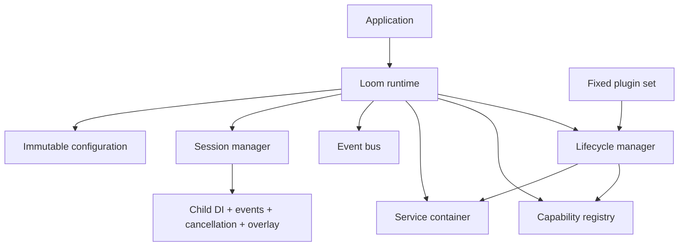

# Architecture

## Purpose

Loom Core composes capabilities without knowing their providers. A runtime instance accepts a fixed
plugin set and immutable configuration, validates the complete graph, then coordinates lifecycle,
registries, services, events, and sessions. Every piece of mutable state belongs to that runtime
instance.



## Package boundaries

`@mgravey/loom-types` contains primitives that can be exchanged without pulling in a runtime. It has
no internal dependency. `@mgravey/loom-plugin-api` depends only on those primitives and defines
contracts for plugin authors. `@mgravey/loom-core` implements those contracts and depends only on
the two lower-level packages. Plugins and examples consume public exports and never import
implementation files.

Phase 2 adds `@mgravey/loom-tool-workspace` above the plugin API and `@mgravey/loom-agent-codex`
above both. These are ordinary plugins, not new core layers. The agent protocol and workspace
semantics cannot flow back into `@mgravey/loom-core`.

Phase 3 adds `@mgravey/loom-platform-browser`, `@mgravey/loom-storage-indexeddb`, and
`@mgravey/loom-workspace-fsa` as host-specific leaves. They compile with browser typings and receive
host objects explicitly, while the packages below them retain their environment-neutral boundary.
See [the browser-platform guide](./browser-platform.md) and
[ADR-007](./adr/007-explicit-browser-hosts.md).

Phase 4 adds a separate credential path. `@mgravey/loom-credential-broker-api` owns the
transport-neutral message protocol. Both the Manifest V3 `@mgravey/loom-extension` and the
application-side `@mgravey/loom-auth-extension` depend on that protocol without depending on one
another. The auth adapter registers the existing minimal `AuthProvider` contract; the extension
never becomes a core service or runtime singleton. See
[the credential-broker guide](./credential-broker.md) and
[ADR-008](./adr/008-extension-credential-boundary.md).

Phase 5 extracts `@mgravey/loom-credential-provider-api` as a host-neutral provider SPI above the
broker protocol. The generic extension consumes that SPI without knowing concrete providers.
`@mgravey/loom-auth-codex-experimental` implements the source-audited OAuth request shapes using
injected host services, while `@mgravey/loom-extension-codex-experimental` is the only Chrome/Codex
composition root. Both are removable leaves: they do not change Core, plugin contracts, or the
external broker protocol. See [the experiment guide](./codex-auth-experiment.md) and
[ADR-009](./adr/009-codex-auth-experiment-boundary.md).

Phase 5.5 adds `@mgravey/loom-model-codex-experimental` as another removable leaf above the Phase 2
model protocol. The experimental extension owns login and refresh state, while an explicitly
approved localhost origin receives only short-lived direct credentials and performs every non-auth
provider request itself when browser CORS permits. A pre-response failure falls back to a
credential-free request over an authorized extension Port. The reusable website side of that Port is
published separately as `@mgravey/loom-companion-codex-experimental`; it owns origin-approval
requests, the Chrome Port lifecycle, response validation, streaming, and cancellation without
receiving credentials. A successful stream closes with a request-scoped `end`/`end-ack` handshake:
the Companion finishes the response before acknowledging it, and the extension retains a bounded
fallback timeout for older clients. Disconnect before `end` remains a transport failure. The model
path does not change Core, the generic credential broker, or the agent contract. See
[the vertical-slice guide](./phase-5-5-vertical-slice.md),
[ADR-013](./adr/013-direct-experimental-model-fetch.md), and
[ADR-015](./adr/015-cors-relay-fallback.md).

`@mgravey/loom-model-openai-responses` is a separate removable leaf for the documented OpenAI
Platform Responses API. It uses the agent-owned optional continuation and caller fields to replay
stateless reasoning and hosted-program items without moving provider wire formats into Core. Its
preferred transport is credential-free from Loom's perspective and implemented by a trusted
application backend. See [the Platform Responses guide](./openai-responses.md) and
[ADR-011](./adr/011-platform-responses-programs.md).

The package also exposes a separately identified OpenAI-compatible Responses capability. It uses
only portable stateless input/function items, optional injected Bearer authentication, and bounded
SSE-or-JSON decoding. The browser workbench owns explicit endpoint selection, model discovery, CORS
fetch, and origin-scoped settings. No local-network authority enters Core or Companion. See
[the local-model guide](./local-models.md) and
[ADR-016](./adr/016-direct-openai-compatible-responses.md).

`@mgravey/loom-model-anthropic-messages` is a parallel removable leaf for the Anthropic Messages
API. It depends only on the public agent, plugin, and type contracts, replays assistant content
blocks as opaque continuation items, and receives credentials only through an injected transport.
Its optional direct transport obtains a user-supplied API key or bearer token per request.

`@mgravey/loom-auth-chatgpt-browser` is a browser leaf above the portable adapter. It owns the
documented Sign in with ChatGPT loopback flow, in-memory token lifetime, refresh, revocation, model
discovery, and a credential-free `OpenAICompatibleResponsesTransport`. Hosts inject the app name,
callback path, message type, metadata storage, notices, `fetch`, and clock; nothing in it refers to
a particular application.

The browser workbench adds two more removable layers. `@mgravey/loom-coding` owns application-level
coding session lifecycle and composes the existing model, agent, and tool contracts without entering
Core. `@mgravey/loom-execution-browser` owns credential-free QuickJS, WebContainer, and Pyodide
adapters. Expanded `ProjectWorkspace` contracts remain environment-neutral in
`@mgravey/loom-tool-workspace`; memory and FSA/ OPFS implementations sit above them. See
[the browser workbench guide](./browser-coding-workbench.md).

Core and portable plugin TypeScript projects compile with `lib: ["ES2022"]`. DOM and Node typings
are not available to that production source. Browser-leaf packages add only the browser libraries
they implement. This preserves portable ESM for a browser window, dedicated Web Worker, or a
compatible non-browser host while isolating host APIs.

See [ADR-005](./adr/005-package-boundaries.md).

## Composition sequence

1. Construct a runtime from the complete plugin list and JSON configuration.
2. Validate namespaced IDs, semantic versions, API compatibility, duplicate IDs, missing required
   dependencies, and required-dependency cycles before any hook runs.
3. Compute one stable topological order. Plugins with equal graph priority retain their input order.
4. Run `initialize` in forward order. Only the active plugin may register capabilities or services.
5. Freeze registration and run `start` in forward order. Optional dependencies can now be resolved
   because every plugin has initialized.
6. While running, create isolated sessions and resolve registered capabilities by explicit ID.
7. Close sessions in reverse creation order, then run plugin `stop` and `dispose` in reverse
   topological order.

The lifecycle is one-shot:

```text
created -> initialized -> running -> stopped -> disposed
    \            \           \          \
     +------------+-----------+-----------> failed
```

There is no restart or live plugin mutation. Failed initialization/startup performs best-effort
rollback and reports all cleanup errors rather than hiding later failures. See
[ADR-001](./adr/001-one-shot-lifecycle.md) and [ADR-002](./adr/002-plugin-dependencies.md).

## Capability registry

A capability key is structural: a namespaced capability kind plus a namespaced implementation ID. It
does not depend on class identity, symbols from a particular bundle, priority, or feature detection.
Multiple implementations in the same category coexist. Selection always names an ID; the runtime
never chooses a default.

The initial categories are agent, model, authentication, tool, storage, execution runtime, memory,
platform, and optional UI. Registration helpers are conveniences over one generic mechanism.
Ownership is inferred from the plugin whose `initialize` hook is executing, allowing complete
cleanup after failure or disposal.

Consumers receive a read-only view with exact lookup, optional lookup, membership, and snapshot
listing. The snapshot cannot mutate the registry.

## Services versus capabilities

Capabilities are discoverable ecosystem integrations. DI services are implementation wiring. They
occupy separate registries and use different keys so an internal helper never becomes a public
capability accidentally.

Service registrations have runtime-singleton, session, or transient lifetimes. Resolution supports
async factories, detects missing and circular dependencies, and records created disposable values.
Each scope disposes its values in reverse creation order. See
[ADR-003](./adr/003-service-scopes.md).

## Events and error reporting

Every runtime has its own typed event bus. A session receives a separate event scope rather than a
global channel. Handlers execute serially in subscription order, every handler is attempted, and
handler errors go to the runtime error sink. Event listener failures do not alter lifecycle state.
Payloads emitted by core are immutable.

This contract favors deterministic observation over throughput. See
[ADR-004](./adr/004-event-delivery.md).

## Configuration and sessions

Configuration is JSON-only and keyed by plugin ID. Runtime construction rejects keys for plugins
that are not installed, then clones and recursively freezes the accepted values. A plugin sees only
its own configuration.

A session is an in-memory execution scope, not a conversation. Callers provide its ID. A session
owns immutable metadata, a plugin configuration overlay, child service scope, event scope, and
cancellation state. An explicitly supplied plugin overlay replaces that plugin's runtime value; it
is not recursively merged. Closing is idempotent and deterministic.

Core sessions still do not imply conversation persistence. `@mgravey/loom-coding` is an
application-owned conversation manager: it keeps a transcript, contextualizes follow-ups, serializes
active work, and owns cancellation without changing Core session semantics.

## Minimal agent composition

The coding agent is resolved by an explicit capability key and constructed outside core from an
explicitly selected model, any built-in workspace or application-defined schema tools, optional
memory, and the agent's immutable session configuration. The model and tools receive the same
operation context as the agent run. Application tools use unique namespaced operations and keep
their implementation authority outside Core.

The workspace tools operate only through an injected text-workspace adapter. The deterministic
in-memory adapter and scripted model in `@mgravey/loom-examples` demonstrate composition; they are
not defaults or production providers. See [the minimal-agent guide](./minimal-agent.md) and
[ADR-006](./adr/006-agent-owned-protocol.md).

## Extension credential boundary

The application page is outside the credential trust boundary. It sends a versioned `getAccessToken`
envelope to an explicitly identified extension. Chrome's `externally_connectable` manifest entry is
a coarse routing gate; the service worker separately validates the sender's exact origin before
parsing the message or looking up a provider.

Refresh credentials belong only to the extension's trusted storage. The service worker may cache a
short-lived access token in memory and returns only that token and its expiry. A Loom auth plugin
adapts this response to `AuthProvider.getAccessToken()` without exposing extension APIs to core.
Service-worker restart may discard the access-token cache, but the next authorized request can
refresh from extension-owned state.

Phase 5.5 adds safe status and logout operations to that versioned protocol. The experimental model
request uses a different Port protocol because account routing, Responses request bodies, and SSE
are provider-specific. The extension resolves its own token and account routing ID for each model
request. The page receives neither credential.

## Deferred architecture

Phase 3 supplies browser storage and filesystem access, and Phase 4 supplies mock-backed extension
credential brokering, without changing runtime lifecycle or registry semantics. Phase 5 supplies an
unsupported, disabled-by-default Codex authentication experiment as a separate leaf. Phase 5.5
proves an experimental vertical slice without promoting its provider contracts into Core. Supported
OAuth/Codex authentication, production credential hosting and deployment, and additional agents
remain future independent plugins. Browser execution is now available as a leaf package, but package
installation, shell fidelity, Git integration, and hard Worker termination are still application
concerns. The documented Platform Responses model adapter does not promote its provider contract
into Core or make the ChatGPT experiment supported.
