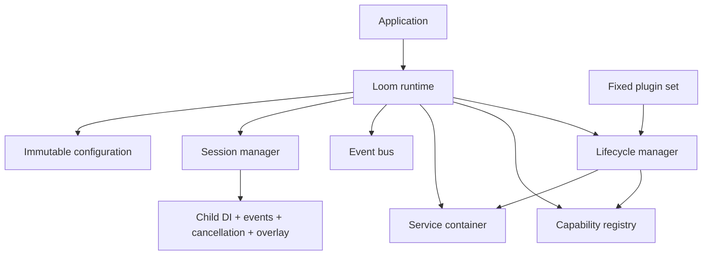

# Architecture

## Purpose

Loom Core composes capabilities without knowing their providers. A runtime instance accepts a fixed
plugin set and immutable configuration, validates the complete graph, then coordinates lifecycle,
registries, services, events, and sessions. Every piece of mutable state belongs to that runtime
instance.



## Package boundaries

`@loom/types` contains primitives that can be exchanged without pulling in a runtime. It has no
internal dependency. `@loom/plugin-api` depends only on those primitives and defines contracts for
plugin authors. `@loom/core` implements those contracts and depends only on the two lower-level
packages. Plugins and examples consume public exports and never import implementation files.

Phase 2 adds `@loom/tool-workspace` above the plugin API and `@loom/agent-codex` above both. These
are ordinary plugins, not new core layers. The agent protocol and workspace semantics cannot flow
back into `@loom/core`.

Runtime package TypeScript projects compile with `lib: ["ES2022"]`. DOM and Node typings are not
available to production source. This is stricter than merely avoiding browser globals: it ensures
the same ESM can be evaluated in a browser window, a dedicated Web Worker, or a compatible
non-browser host.

See [ADR-005](./adr/005-package-boundaries.md).

## Composition sequence

1. Construct a runtime from the complete plugin list and JSON configuration.
2. Validate namespaced IDs, semantic versions, API compatibility, duplicate IDs, missing required
   dependencies, and required-dependency cycles before any hook runs.
3. Compute one stable topological order. Plugins with equal graph priority retain their input order.
4. Run `initialize` in forward order. Only the active plugin may register capabilities or services.
5. Freeze registration and run `start` in forward order. Optional dependencies can now be resolved
   because every plugin has initialized.
6. While running, create isolated sessions and resolve registered capabilities by explicit ID.
7. Close sessions in reverse creation order, then run plugin `stop` and `dispose` in reverse
   topological order.

The lifecycle is one-shot:

```text
created -> initialized -> running -> stopped -> disposed
    \            \           \          \
     +------------+-----------+-----------> failed
```

There is no restart or live plugin mutation. Failed initialization/startup performs best-effort
rollback and reports all cleanup errors rather than hiding later failures. See
[ADR-001](./adr/001-one-shot-lifecycle.md) and [ADR-002](./adr/002-plugin-dependencies.md).

## Capability registry

A capability key is structural: a namespaced capability kind plus a namespaced implementation ID. It
does not depend on class identity, symbols from a particular bundle, priority, or feature detection.
Multiple implementations in the same category coexist. Selection always names an ID; the runtime
never chooses a default.

The initial categories are agent, model, authentication, tool, storage, execution runtime, memory,
platform, and optional UI. Registration helpers are conveniences over one generic mechanism.
Ownership is inferred from the plugin whose `initialize` hook is executing, allowing complete
cleanup after failure or disposal.

Consumers receive a read-only view with exact lookup, optional lookup, membership, and snapshot
listing. The snapshot cannot mutate the registry.

## Services versus capabilities

Capabilities are discoverable ecosystem integrations. DI services are implementation wiring. They
occupy separate registries and use different keys so an internal helper never becomes a public
capability accidentally.

Service registrations have runtime-singleton, session, or transient lifetimes. Resolution supports
async factories, detects missing and circular dependencies, and records created disposable values.
Each scope disposes its values in reverse creation order. See
[ADR-003](./adr/003-service-scopes.md).

## Events and error reporting

Every runtime has its own typed event bus. A session receives a separate event scope rather than a
global channel. Handlers execute serially in subscription order, every handler is attempted, and
handler errors go to the runtime error sink. Event listener failures do not alter lifecycle state.
Payloads emitted by core are immutable.

This contract favors deterministic observation over throughput. See
[ADR-004](./adr/004-event-delivery.md).

## Configuration and sessions

Configuration is JSON-only and keyed by plugin ID. Runtime construction rejects keys for plugins
that are not installed, then clones and recursively freezes the accepted values. A plugin sees only
its own configuration.

A session is an in-memory execution scope, not a conversation. Callers provide its ID. A session
owns immutable metadata, a plugin configuration overlay, child service scope, event scope, and
cancellation state. An explicitly supplied plugin overlay replaces that plugin's runtime value; it
is not recursively merged. Closing is idempotent and deterministic.

Persistence and conversation history belong in future storage and memory plugins. Active agent runs
are application-owned operations: session close cancels their signal but does not turn sessions into
conversation managers.

## Minimal agent composition

The Phase 2 coding agent is resolved by an explicit capability key and constructed outside core from
an explicitly selected model, the three workspace tools, optional memory, and the agent's immutable
session configuration. The model and tools receive the same operation context as the agent run.

The workspace tools operate only through an injected text-workspace adapter. The deterministic
in-memory adapter and scripted model in `@loom/examples` demonstrate composition; they are not
defaults or production providers. See [the minimal-agent guide](./minimal-agent.md) and
[ADR-006](./adr/006-agent-owned-protocol.md).

## Deferred architecture

Later work may add browser storage and filesystem access, credential brokering, model providers,
additional agents, and execution environments as plugins. Such work must not require changes to
runtime lifecycle or registry semantics.
