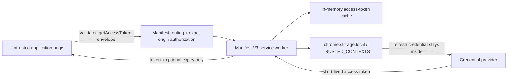

# Extension credential broker

Phase 4 adds a provider-neutral credential boundary without adding Chrome or OAuth knowledge to Loom
Core. Four packages divide the responsibilities:

- `@loom/credential-broker-api` defines the transport-independent `CredentialBroker` interface,
  namespaced provider IDs, versioned request/response envelopes, validation, and typed errors;
- `@loom/auth-extension` sends validated requests through an explicitly supplied external-message
  runtime and registers the result as Loom's minimal `AuthProvider` capability;
- `@loom/extension` is a Manifest V3 service worker that authorizes page origins, owns refresh
  credentials, coordinates refreshes, and returns short-lived access tokens;
- `@loom/example-extension` is an application page proving public-API composition with the bundled
  mock provider.

The broker protocol is generic. It is not shaped around OpenAI, Codex, or another provider and does
not encode an OAuth authorization flow.

## Trust boundary



The page is not trusted with refresh state. It knows the installed extension ID and sends a
`loom/credential-broker` protocol-version-1 request through `chrome.runtime.sendMessage`. The
extension ID selects a destination; it is not authorization by itself.

Chrome's
[`externally_connectable`](https://developer.chrome.com/docs/extensions/develop/concepts/messaging#external-webpage)
manifest entry controls which pages Chrome will route to the extension. Match patterns cannot pin a
localhost port, so the development manifest's `http://localhost/*` and `http://127.0.0.1/*` entries
are deliberately only a coarse outer gate. The service worker then requires exactly
`http://localhost:4173` or `http://127.0.0.1:4173`.

The authorizer accepts only configured HTTP(S) origins with no path, credentials, or trailing slash.
For each request it validates `sender.origin` when present, derives the origin from `sender.url` as
needed, rejects opaque or malformed values, and rejects disagreement between the two fields.
Authorization happens before protocol parsing or provider lookup.

After authorization, the extension strictly validates the complete versioned envelope. Unknown keys,
malformed IDs, unsupported versions, invalid request IDs, and mismatched response IDs do not cross
the adapter silently. Responses use stable provider-neutral error codes.

## Credential ownership

Refresh credentials are written under namespaced keys in `chrome.storage.local`. Before the first
credential initialization, the service worker awaits
`setAccessLevel({ accessLevel: 'TRUSTED_CONTEXTS' })`, restricting access to contexts originating
from the extension. See Chrome's
[`chrome.storage` documentation](https://developer.chrome.com/docs/extensions/reference/api/storage)
for the access-level contract.

Only a short-lived access token and optional expiry may leave the service worker. A refresh
credential must never enter:

- the application page or its logs;
- Loom runtime or session configuration;
- Loom events or error messages;
- the general IndexedDB storage plugin;
- agent or tool inputs.

Provider failures are mapped to sanitized messages. The token service caches valid access tokens in
service-worker memory, refreshes them before expiry using a configurable skew, deduplicates
concurrent refreshes per provider, and persists a rotated refresh credential before returning the
new access token. A service-worker restart discards only the access-token cache; persistent refresh
state remains extension-owned.

Phase 4 does not claim that `chrome.storage.local` encrypts credentials against a compromised local
machine or malicious extension code. `TRUSTED_CONTEXTS`, exact-origin validation, minimal
permissions, and the absence of content scripts reduce exposure within the extension architecture;
operating-system and Chrome-profile security remain outside Loom's boundary.

## Development extension

The checked-in Manifest V3 extension is an integration fixture, not an authentication product. It
registers only `loom/mock`, initializes a development-only mock refresh value, and generates
deterministic short-lived access tokens. It has no provider network calls, login UI, consent flow,
revocation, logout, or account selection.

Build and load it:

```sh
pnpm build
```

1. Open `chrome://extensions` in Chrome.
2. Enable Developer mode and choose **Load unpacked**.
3. Select `packages/extension/dist` and copy the generated extension ID.
4. Serve the package directory:

   ```sh
   python3 -m http.server 4173 --directory packages
   ```

5. Open `http://localhost:4173/example-extension/`, enter the extension ID, and request a token.

The example deliberately displays the mock access token so the boundary is observable. A real
application should minimize access-token display, retention, and logging.

## Testing

Unit tests cover protocol validation, adapter failures, exact-origin rules, trusted storage
initialization, token caching, expiry, rotation, refresh deduplication, missing credentials, unknown
providers, and failure sanitization.

The browser suite builds and loads the actual unpacked extension into a persistent Chromium context,
discovers its service worker and generated extension ID, and sends messages from real pages. It
tests the public example, two simultaneous requests, unauthorized port `4174`, unknown providers,
and removal of the stored mock refresh credential. This follows Playwright's
[Chrome extensions guide](https://playwright.dev/docs/chrome-extensions) and Chrome's
[end-to-end testing guidance](https://developer.chrome.com/docs/extensions/how-to/test/end-to-end-testing).

Run the complete suite with:

```sh
pnpm check
```

## Deferred to Phase 5

Phase 5 may investigate Codex CLI OAuth and PKCE as an experimental credential-provider
implementation. That work must plug into the broker contracts without changing Loom Core or the
Phase 4 transport. If the experiment is unsupported or later replaced, the runtime and existing auth
capability remain unchanged.
